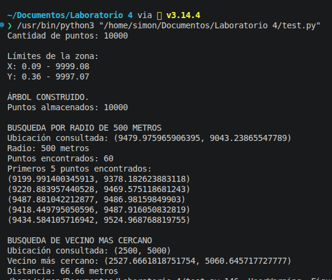
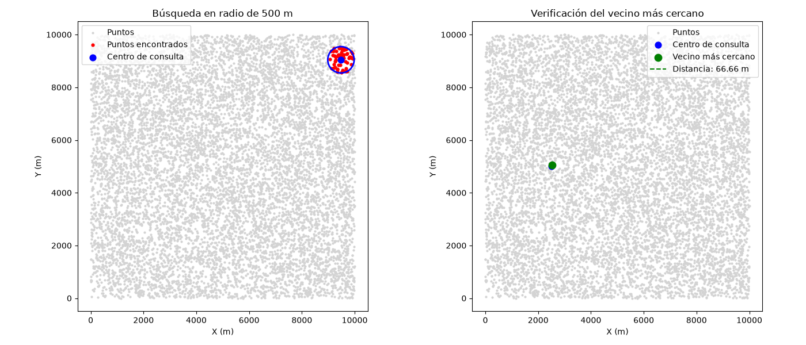
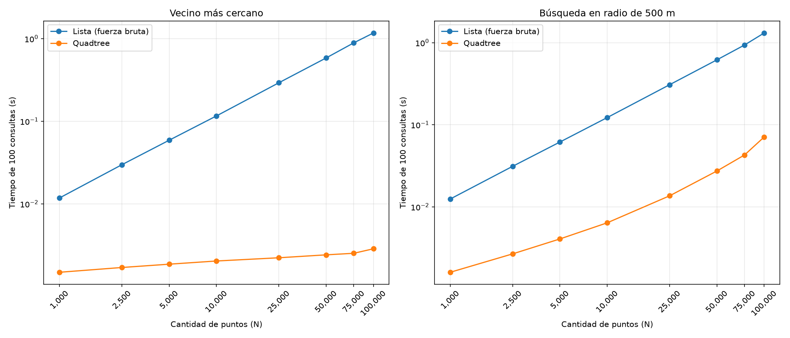

# QUADTREE VS FUERZA BRUTA
En este proyecto se implementó la estructura de datos **quadtree** para analizar su eficiencia y funcionamiento en la localización de puntos cercanos y en la búsqueda de puntos situados dentro de un radio determinado.


## Tabla de contenidos

- [Problema](#problema)
- [Objetivos](#objetivos)
- [Implementación](#implementación)
- [Pruebas](#pruebas)
- [Comparación](#comparación)
- [Analisis](#analisis)
- [Instalación](#instalación)
- [Uso](#uso)
- [Codigo de Honor](#código-de-honor)

## Problema
Eres parte de un equipo que desarrolla un sistema de logística de entregas en una ciudad. Tienes coordenadas (x,y) de 10.000 puntos de entrega. Necesitas implementar un sistema que responda eficientemente preguntas como:
- ¿Qué puntos de entrega estan a un radio de 500 metros de un punto dado?
- ¿Cual es el punto de entrega mas cercano a una ubicacion dada?

## Objetivo
Implementar un Arbol-Quadtree desde cero, y comparar con fuerza bruta en estos dos casos.

## Implementación

La implementación del árbol se encuentra en el archivo `quadtree.py`. En este archivo se
definen dos clases: `NodoQuadtree` y `Quadtree`.

### Clase `NodoQuadtree`

Esta clase representa cada parte del árbol. Cada nodo contiene los límites de una
zona, los puntos que se encuentran en ella y, cuando es necesario, cuatro zonas
más pequeñas.

Sus principales métodos son:

- `insertar(punto)`: agrega un punto a la zona correspondiente. Si la zona alcanza
  su capacidad, se divide en cuatro partes.
- `subdividir()`: divide la zona actual en cuatro zonas más pequeñas.
- `insertar_en_hijo(punto)`: identifica en cuál de las cuatro zonas debe guardarse
  un punto.
- `intersecta_radio(centro, radio)`: comprueba si una zona puede tener puntos
  dentro del radio indicado.
- `buscar_radio(centro, radio)`: busca y devuelve los puntos que se encuentran
  dentro de un radio determinado.
- `distancia_minima(centro)`: calcula la distancia mínima entre un punto y una zona.
- `buscar_mas_cercano(centro)`: busca el punto más cercano a una ubicación.
- `contar_puntos()`: cuenta cuántos puntos contiene una zona y sus zonas internas.

### Clase `Quadtree`

Esta clase representa el árbol completo y facilita el uso de la estructura. Crea
el primer nodo, llamado raíz, y utiliza los métodos de `NodoQuadtree` para
trabajar con todos los puntos.

Sus métodos son:

- `insertar(punto)`: agrega un solo punto al árbol.
- `insertar_puntos(puntos)`: agrega una lista de puntos al árbol.
- `buscar_radio(centro, radio)`: devuelve los puntos cercanos a una ubicación
  dentro del radio indicado.
- `contar_puntos()`: devuelve la cantidad total de puntos guardados.
- `buscar_vecino_mas_cercano(centro)`: devuelve el punto más cercano y la
  distancia hasta él.

### Funcionamiento

Al comenzar, el árbol tiene una sola zona que contiene todos los límites. Los
primeros puntos se guardan en esta zona. Cuando se alcanza la capacidad máxima,
la zona se divide en cuatro partes y los puntos se distribuyen en la zona que
les corresponde.

Para buscar puntos dentro de un radio, el árbol revisa únicamente las zonas que
pueden contener resultados y descarta las demás. Para encontrar el punto más
cercano, revisa primero las zonas que están más cerca de la ubicación consultada.
De esta manera, no es necesario recorrer todos los puntos como ocurre al usar
una lista común.

## Pruebas
Luego de la construcción del Quadtree, se realizaron pruebas de su funcionamiento
en el archivo `test.py`. Para este propósito, con ayuda de la librería `random`
de Python, se generaron 10.000 puntos dentro de una zona de 10.000 por 10.000
metros.

Para que los resultados fueran iguales cada vez que se ejecuta el programa, se
utilizó la semilla `42`. El árbol se creó con una capacidad de `4` puntos por
zona. Esto significa que una zona se divide en cuatro partes cuando alcanza
esta cantidad de puntos.

### Prueba en la consola

En la primera prueba se construyó el árbol y se comprobó que almacenara los
10.000 puntos generados. Después, se realizaron dos consultas:

- **Búsqueda por radio:** se tomó como centro de consulta el punto número
  5.000 y se utilizó un radio de `500 metros`. El programa muestra la cantidad
  de puntos encontrados y los primeros cinco resultados.
- **Vecino más cercano:** se utilizó como centro de consulta el punto
  `(2500, 5000)`. El programa muestra el punto más cercano y la distancia entre
  ambos puntos.

La salida de estas pruebas se puede observar en la siguiente imagen:



### Verificación visual

También se generó una imagen para observar los resultados de las consultas.
Los puntos de color gris representan todos los puntos utilizados en la prueba.

En la gráfica de la izquierda, el punto azul representa el centro de consulta,
el círculo azul representa el radio de `500 metros` y los puntos rojos son los
puntos encontrados dentro de ese radio.

En la gráfica de la derecha, el punto azul representa la ubicación consultada
y el punto verde representa el vecino más cercano. La línea punteada muestra
la distancia entre ambos puntos.



## Comparación

Para comparar el funcionamiento del `Quadtree` con fuerza bruta, se utilizo una lista común, en el archivo `analisis.py`. En ambos casos se trabajó con los mismos puntos y las mismas ubicaciones de consulta, para que la comparación se realizara bajo las mismas condiciones.

### Parámetros de la experimentación

Se generaron puntos dentro de una zona de `10.000 por 10.000 metros`. Para
obtener los mismos datos en cada ejecución se utilizó la semilla `42`. La
cantidad de puntos se aumentó progresivamente usando los siguientes tamaños:

`1.000`, `2.500`, `5.000`, `10.000`, `25.000`, `50.000`, `75.000` y `100.000`.

Para cada cantidad de puntos se construyó un nuevo Quadtree con una capacidad
de `4` puntos por zona.

Se midieron dos operaciones: encontrar el vecino más cercano y buscar los
puntos que se encuentran dentro de un radio de `500 metros`. Para cada tamaño
se realizaron `100 consultas` y el proceso se repitió `3 veces`. El tiempo
presentado corresponde al promedio de esas repeticiones.

Antes de medir los tiempos, se comprobó que la lista y el Quadtree entregaran
los mismos resultados para las dos operaciones. De esta manera, la comparación
se realizó entre métodos que resuelven el mismo problema.

### Gráfica de comparación

La siguiente imagen muestra los tiempos obtenidos. La gráfica de la izquierda
corresponde a la búsqueda del vecino más cercano y la de la derecha a la
búsqueda de puntos dentro de un radio de `500 metros`.

En ambas gráficas, el eje horizontal representa la cantidad de puntos y el eje
vertical muestra el tiempo empleado en las `100 consultas`, expresado en
segundos. La línea azul representa la lista mediante fuerza bruta y la línea
naranja representa el Quadtree.



## ANALISIS

De acuerdo con los resultados de la comparación, el árbol **Quadtree** comienza
a ser más rápido que la búsqueda por fuerza bruta desde los `1.000 puntos`,
que es el primer tamaño evaluado.

Esto se observa en las dos operaciones analizadas: la búsqueda del vecino más
cercano y la búsqueda de puntos dentro de un radio de `500 metros`. En ambas
gráficas, la línea del Quadtree se encuentra por debajo de la línea de la lista,
lo que indica que necesita menos tiempo para realizar las `100 consultas`.

Por lo tanto, dentro de los tamaños probados, no fue necesario esperar a que la
cantidad de datos aumentara para observar una ventaja del Quadtree. Desde la
primera prueba, con `1.000 puntos`, presentó un menor tiempo que la fuerza
bruta.

## Uso

Para ejecutar el proyecto se debe abrir una terminal en la carpeta principal y
tener Python instalado junto con las librerías utilizadas.

### Ejecutar las pruebas

El archivo `quadtree.py` contiene la implementación del árbol. No se ejecuta
directamente, ya que es utilizado por los otros archivos del proyecto.

Para ejecutar las pruebas generales se utiliza:

```bash
python3 test.py
```

Este archivo genera 10.000 puntos, construye el árbol y realiza las búsquedas
por radio y de vecino más cercano. Como resultado, muestra la información en
la terminal y crea la imagen
`verificacion_visual_quadtree.png`.

### Ejecutar la comparación

Para comparar el Quadtree con la lista mediante fuerza bruta se utiliza:

```bash
python3 analisis.py
```

Este archivo realiza las consultas con diferentes cantidades de puntos y
muestra los tiempos obtenidos en la terminal. También crea la imagen
`comparacion_quadtree_vs_lista.png`, que contiene las gráficas de comparación.
